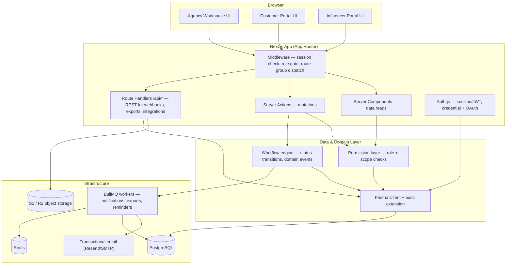
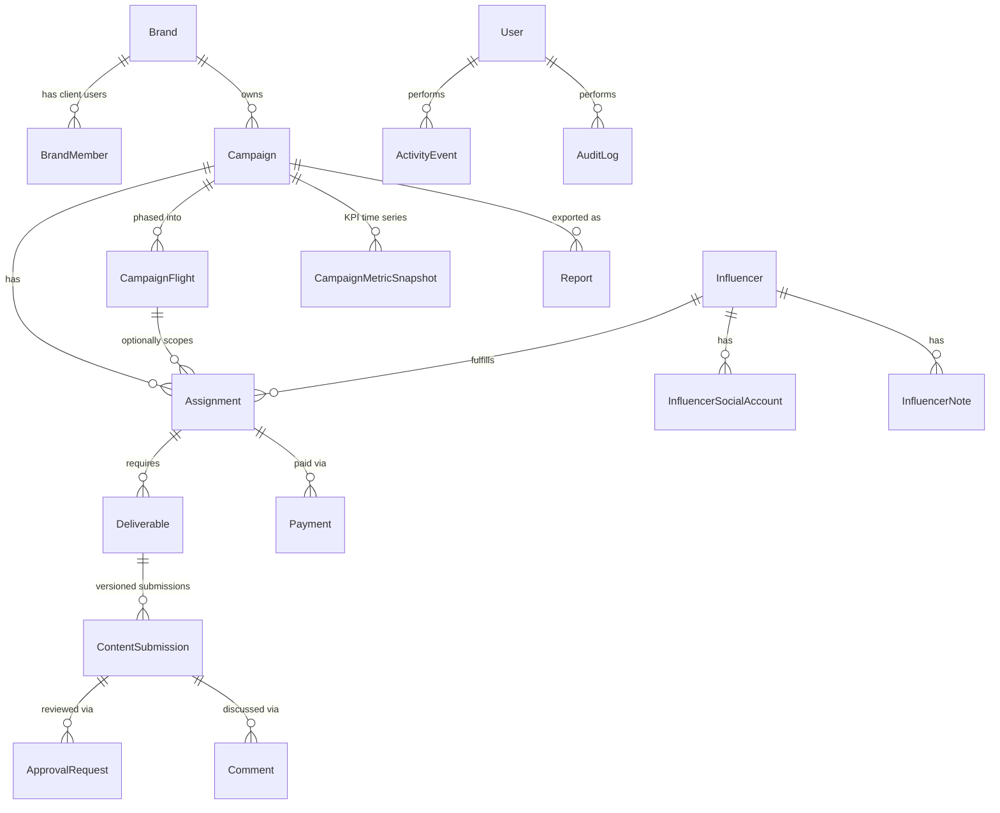

# Octagon — Influencer Marketing & Campaign Management Platform

System architecture and design decisions. Read this before touching code — it is the contract the implementation follows.

## 1. What this system is

One Next.js application serving **three audiences** against **one PostgreSQL database**:

| Portal | Who | Access pattern |
|---|---|---|
| Agency Workspace | Internal staff (admins, campaign managers, coordinators) | Full read/write, scoped by team/role |
| Customer Portal | Brand/client stakeholders | Read-only, scoped to their own brand(s) |
| Influencer Portal | Creators under contract | Read/write on their own assignments only |

A single codebase and single database — not three separate apps — because all three views are projections of the same underlying campaign data, and an agency tool's core value is that the client and the influencer see a consistent, live picture of what the internal team is doing. Splitting into separate deployments would mean duplicating auth, duplicating the domain model, and building a sync layer between them for no real benefit at this scale. The three portals differ in **navigation shell, permissions, and query scope** — not in data model.

## 2. High-level architecture



## 3. Technology decisions

Every choice below is picked for a reason specific to this domain — not "best practice by default."

| Area | Choice | Why |
|---|---|---|
| Framework | Next.js App Router, TS | Server Components let each portal fetch pre-scoped data server-side, so a client user can never even receive another brand's JSON — the query is scoped before it leaves the server. |
| DB | PostgreSQL + Prisma | Relational integrity matters here: assignments reference campaigns reference brands reference contacts; foreign keys and transactions prevent orphaned/ghost records that a document DB would let slip through. |
| Auth | Auth.js (NextAuth v5) + Prisma adapter, **JWT sessions** | Auth.js's Credentials provider (required for internal/client/influencer email+password login) does not support the database session strategy — only OAuth providers persist an `Account` row the adapter can key a database session off. JWT is the only option once Credentials is in play. Revocation is instead handled explicitly: `User.tokenVersion` is bumped on suspend/offboard, and every real data-layer call (§11, `lib/data`/`lib/actions`) re-checks the caller's current `status`/`tokenVersion` against the DB as part of the query it's already making — so a revoked user can't read or write anything from the moment of revocation, even though a cached JWT could still render an empty shell page until it expires (short `maxAge`, e.g. 8h, bounds that window). This gets the practical guarantee that matters (no data access after revocation) without the DB round-trip on every navigation that database sessions would add. |
| Styling | Tailwind CSS v4 + shadcn/ui | shadcn is copied into the repo, not an npm dependency, so every component is ours to theme/extend per-portal (agency vs. client vs. influencer can use different density/branding on the same primitives) without fighting a black-box library. |
| Forms/validation | Zod + react-hook-form | One Zod schema per entity lives in `lib/validations/`, imported by both the client form (`zodResolver`) and the server action/API route that receives it. Validation logic is written exactly once, never drifts. |
| Server mutations | Server Actions (primary) + REST Route Handlers (secondary) | Server Actions for all form-driven mutations inside the app (progressive enhancement, no client-side fetch boilerplate). REST endpoints under `app/api/` only where a plain HTTP contract is actually needed: webhooks (payment/social platform callbacks), signed file uploads, exports polled by the client, and anything a future mobile client or partner integration would call. |
| Client data/cache | React Query | Used for the interactive, client-heavy views only (Kanban-style assignment boards, live notification bell, polling export status) — not for the initial page load, which is server-rendered. Avoids the double-fetch anti-pattern of loading data server-side and then re-fetching it client-side. |
| File storage | S3-compatible object storage (S3 / Cloudflare R2), presigned URLs | Large video deliverables must not be proxied through the Next.js server (request body limits, memory pressure, cost). The browser uploads directly to the bucket via a presigned URL the server issues after a permission check; the server only ever stores metadata. |
| Background jobs | BullMQ + Redis, separate worker process | Report generation (PDF/Excel), digest emails, deadline-reminder sweeps, and webhook fan-out must survive a request/response cycle and retry on failure. Since the app is containerized (not pure serverless), a long-running worker process is the natural fit — simpler and cheaper than a serverless queue product for this workload. |
| PDF export | `@react-pdf/renderer` | Reports are React components — the same KPI layout used on-screen is reused to render the PDF, so the two never visually diverge. |
| Excel export | `exceljs` | Streaming writer, handles large row counts (influencer-level metric breakdowns) without loading the whole workbook into memory. |
| Testing | Vitest (unit/integration) + Testing Library (components) + Playwright (E2E) | Vitest shares config/transform with the Next.js toolchain (fast, ESM-native). Playwright covers the one thing unit tests can't: that a client-role user genuinely cannot navigate into agency-only routes. |
| Containers | Docker (multi-stage), docker-compose for local dev | Local dev spins up Postgres, Redis, MinIO (S3-compatible), and Mailhog (SMTP sink) so the whole stack — including uploads and email — is testable offline, without touching a cloud account. |
| CI/CD | GitHub Actions | Lint → typecheck → unit tests → Playwright → build → (on main) build & push Docker image, run Prisma migrate deploy. |

## 4. Routing strategy: one app, three portals

Each portal gets a real top-level URL segment — `/agency`, `/customer`, `/influencer` — not a Next.js *route group* (`(agency)`), because route groups are stripped from the URL and `/agency/dashboard` / `/customer/dashboard` would otherwise both resolve to `/dashboard` and collide. `(auth)` is the one genuine route group here: `/sign-in` and `/invite/[token]` don't share a prefix and don't need one.

```
app/
  (auth)/              # shared: sign-in, invite-accept — no URL prefix needed
  agency/              # internal workspace — requires role in AGENCY_* set
  customer/            # client portal — requires role in CLIENT_* set
  influencer/          # influencer portal — requires role INFLUENCER
  api/                 # REST route handlers
```

`proxy.ts` (Next.js 16's renamed `middleware.ts` — same mechanism, runs on the Node.js runtime by default now) reads the session, determines the caller's role, and:
1. Redirects unauthenticated requests to `/sign-in`.
2. Blocks a role from entering another portal's URL prefix (e.g., an `INFLUENCER` hitting `/agency/*` gets a 404, not a 403 — we don't reveal the route exists).
3. Does **not** do row-level scoping itself (that needs DB context) — it only gates by *portal*. Row-level scoping (which brands/campaigns a client can see) happens in the data-access layer on every query, never trusted to proxy alone. This is defense in depth: even if a route-level check were ever missed, the query layer still won't return another tenant's rows.

## 5. RBAC model

Roles are intentionally flat (`Role` enum on `User`, not a separate roles table) because the permission set per role is fixed and small — a configurable roles/permissions table would be speculative complexity for a scope no one has asked for.

```
SUPER_ADMIN      — full platform access, feature flags, all brands/teams
AGENCY_ADMIN     — manage users, brands, teams, all campaigns
AGENCY_MANAGER   — create/manage campaigns, assignments, approvals
AGENCY_MEMBER    — work assigned campaigns, upload/approve content, no admin
CLIENT_ADMIN     — brand-scoped: manage which client users can see the brand
CLIENT_VIEWER    — brand-scoped: read-only dashboards, deliverables, reports
INFLUENCER       — self-scoped: own assignments, uploads, messages, payments
```

Client access is further scoped by brand via `BrandMember` (many-to-many: a client user can belong to multiple brands under a holding company; a brand can have multiple client contacts). Influencer access is self-scoped via `Influencer.userId`. Every data-access function in `lib/data/*` takes the authenticated session and applies the scope filter — there is no code path that queries `Campaign` without a `where` clause derived from the caller's role.

## 6. Domain model (see `prisma/schema.prisma` for full detail)



Two distinct logging tables on purpose:
- **`ActivityEvent`** — human-readable feed ("Jane approved the Instagram Reel for Campaign X"), scoped to a campaign, shown in the UI timeline.
- **`AuditLog`** — forensic/compliance record (actor, action, entity, before/after JSON diff, IP, user agent), not rendered as a friendly feed, exists for security review and dispute resolution. Written by a Prisma Client Extension wrapping every mutation, so it can't be forgotten in a specific action.

## 7. Workflow engine

Not a generic BPMN/rules engine — that would be solving a much bigger problem than this platform has. Instead, each stateful entity gets an explicit, typed transition table in `lib/workflow/`:

```ts
// lib/workflow/campaign.ts
const CAMPAIGN_TRANSITIONS: Record<CampaignStatus, CampaignStatus[]> = {
  DRAFT: ["PENDING_APPROVAL", "CANCELLED"],
  PENDING_APPROVAL: ["ACTIVE", "DRAFT", "CANCELLED"],
  ACTIVE: ["PAUSED", "COMPLETED", "CANCELLED"],
  PAUSED: ["ACTIVE", "CANCELLED"],
  COMPLETED: ["ARCHIVED"],
  CANCELLED: ["ARCHIVED"],
  ARCHIVED: [],
};
```

A `transition(entity, from, to, actor)` helper validates the move is legal, applies it inside a Prisma transaction alongside the `ActivityEvent` + `AuditLog` writes, and enqueues any side effects (notify brand on campaign activation, notify influencer on assignment approval) as a BullMQ job — so a slow email provider never blocks the mutation response. Three transition tables ship in v1: `Campaign`, `Assignment`, `ContentSubmission` (approval lifecycle). This is deliberately simple, testable with plain unit tests (assert illegal transitions throw), and auditable by reading one file per entity instead of tracing a rules engine.

## 8. File uploads

1. Client requests a presigned upload URL from `POST /api/uploads/presign` with `{ entityType, entityId, fileName, mimeType, size }`.
2. Server checks the caller has write access to that entity, validates mime/size against an allowlist, then returns a presigned S3 POST/PUT URL — the file itself never touches the Next.js server.
3. Browser uploads directly to the bucket.
4. Client calls a Server Action to confirm the upload, which creates the `FileAsset` row and, if the target is a `Deliverable`, a new `ContentSubmission` version.

`FileAsset` is polymorphic (`entityType` + `entityId`) rather than a dozen nullable foreign keys, because files attach to many different entities (campaign briefs, content submissions, brand assets, invoices) and a rigid per-entity join table for each would be pure boilerplate.

## 9. Reporting

- KPI numbers (reach, impressions, engagement, views) are stored as periodic snapshots in `CampaignMetricSnapshot` (per campaign, optionally per influencer, per day), not recomputed live from raw platform data — the platform doesn't own the source-of-truth analytics (Instagram/TikTok/YouTube APIs do), it ingests and stores snapshots via a scheduled job, so dashboards render fast off indexed rows instead of hammering external APIs on every page load.
- On-screen dashboards query snapshots directly (Server Component + Postgres aggregate query).
- PDF/Excel export of anything beyond a trivial size is generated asynchronously: the request creates a `Report` row (`status: PENDING`), enqueues a BullMQ job, the client polls (React Query) or gets a notification when `status: READY`, then downloads from the `FileAsset` the job produced. Small exports (a single campaign's summary) can generate synchronously in a Route Handler — the async path exists for the case that would otherwise time out an HTTP request (agency-wide quarterly report across hundreds of influencers).

## 10. Notifications

`Notification` rows are the source of truth for the in-app bell (React Query polling / can upgrade to SSE later). Email is a delivery channel, not a separate system: the same workflow-engine side effect that creates a `Notification` row also enqueues an email job through the same queue, using React Email templates rendered server-side.

## 11. Folder structure

```
octagon/
  app/
    (auth)/                          # route group — no URL prefix
      layout.tsx
      sign-in/page.tsx
      invite/[token]/page.tsx
    agency/                          # real URL segment — /agency/*
      layout.tsx                     # agency shell: sidebar nav, guards AGENCY_* roles
      dashboard/page.tsx
      campaigns/
        page.tsx
        new/page.tsx
        [campaignId]/
          page.tsx
          flights/page.tsx
          assignments/page.tsx
          approvals/page.tsx
          reports/page.tsx
      brands/
        page.tsx
        [brandId]/page.tsx
      influencers/                   # CRM
        page.tsx
        [influencerId]/page.tsx
      teams/page.tsx
      admin/
        users/page.tsx
        roles/page.tsx
        feature-flags/page.tsx
        settings/page.tsx
      audit-log/page.tsx
    customer/                        # real URL segment — /customer/*
      layout.tsx                     # client shell: brand-scoped nav, guards CLIENT_* roles
      dashboard/page.tsx
      campaigns/[campaignId]/page.tsx
      reports/page.tsx
      files/page.tsx
    influencer/                      # real URL segment — /influencer/*
      layout.tsx                     # influencer shell, guards INFLUENCER role
      dashboard/page.tsx
      invitations/page.tsx
      assignments/[assignmentId]/page.tsx
      messages/page.tsx
      payments/page.tsx
    api/
      auth/[...nextauth]/route.ts
      uploads/presign/route.ts
      webhooks/[provider]/route.ts
      reports/[reportId]/download/route.ts
      cron/metrics-sync/route.ts
    layout.tsx
    page.tsx                         # redirects "/" to the caller's portal dashboard
    not-found.tsx
    globals.css
  components/
    ui/                              # shadcn primitives
    agency/                          # portal-specific composed components
    customer/
    influencer/
    auth/                            # sign-in / invite-accept forms
    providers/                       # React Query, theme, tooltip, toaster
    shared/                          # cross-portal (portal shell, stat cards, user menu)
  lib/
    auth/                            # Auth.js config, session helpers, permission checks
    data/                            # scoped query functions per entity (data-access layer)
    actions/                         # Server Actions per entity
    validations/                     # Zod schemas
    workflow/                        # status transition tables
    events/                          # domain event emitter + handlers
    jobs/                            # BullMQ job definitions
    storage/                         # S3 client, presign helpers
    reports/                         # PDF/Excel generators
    email/                           # React Email templates + send helpers
    db.ts                            # Prisma client singleton (driver adapter)
    env.ts                           # Zod-validated environment variables
    utils.ts
  types/
    next-auth.d.ts                   # Session/User/JWT module augmentation
  worker/
    index.ts                        # BullMQ worker entrypoint (separate process/container)
  prisma/
    schema.prisma
    migrations/
    seed.ts
  tests/
    unit/
    integration/
    e2e/
  docker/
    Dockerfile
  docker-compose.yml                 # local infra only: postgres, redis, minio, mailhog
  proxy.ts                           # portal gate (Next.js 16 middleware, renamed)
  prisma.config.ts
  .github/workflows/ci.yml
  docs/
    ARCHITECTURE.md
    ROADMAP.md
```

`lib/data/` vs `lib/actions/` split matters: `data/` is read-only, importable from Server Components; `actions/` is `"use server"` mutations, each starting with a permission check against the session before touching Prisma. No component calls Prisma directly — everything goes through one of these two layers, which is what makes the RBAC guarantee in §5 actually enforceable and testable in one place.

## 12. Security

- Passwords: `argon2` hashing (credentials provider only; OAuth users have none).
- Session cookies: `httpOnly`, `secure` in production, `sameSite: lax`.
- CSRF: Server Actions have built-in origin checking in Next.js; REST routes that mutate state require the session cookie + origin check.
- File upload validation: allowlist MIME types and max size enforced server-side before issuing a presigned URL, never trusting client-declared type alone.
- Rate limiting: sign-in and invite-accept routes rate-limited (Redis token bucket) to blunt credential stuffing.
- Every row-returning query in `lib/data/` is scoped by caller role/brand/influencer — verified by integration tests per portal (§ Testing).

## 13. Testing strategy

- **Unit** (Vitest): workflow transition tables, Zod schemas, permission-check helpers, report calculation logic.
- **Integration** (Vitest + test DB via Testcontainers or a docker-compose Postgres): `lib/data/*` scoping — assert a `CLIENT_VIEWER` for Brand A never receives Brand B's campaigns even by ID guessing.
- **E2E** (Playwright): one full journey per portal — agency creates campaign → assigns influencer → influencer uploads content → agency approves → client sees it on their dashboard. Plus a negative test: influencer role cannot reach `/agency/*`.
- CI runs all three on every PR; Playwright against the docker-compose stack.

## 14. Environments & deployment

Local dev: `docker-compose up` brings up Postgres, Redis, MinIO, Mailhog; `next dev` + `worker` run on the host (or also containerized) with `.env.local` pointing at those services. Production: multi-stage Dockerfile builds a standalone Next.js output; a second image runs the BullMQ worker; both deploy to whatever container platform is chosen (Fly.io/ECS/Railway — infra-agnostic by design, no Vercel-only primitives like Edge Functions used for anything stateful). Migrations run via `prisma migrate deploy` as a release-phase step in CI, never `db push` in production.
